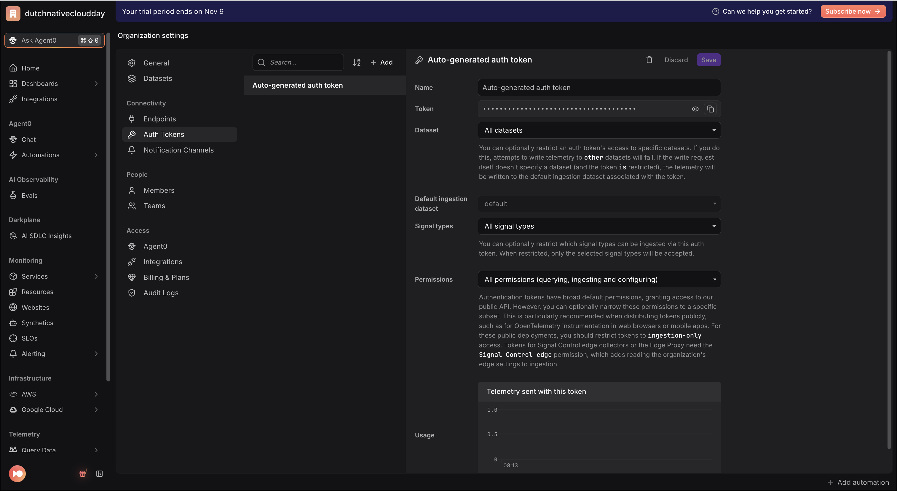
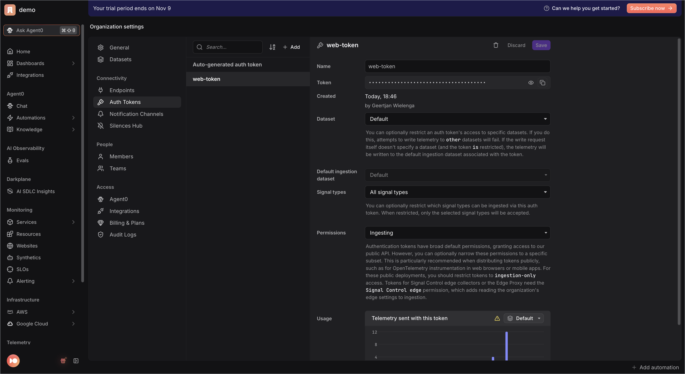
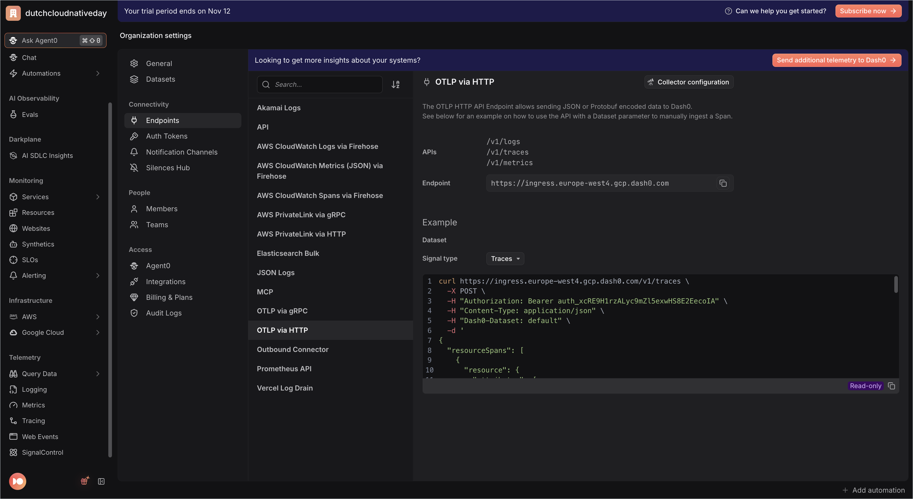
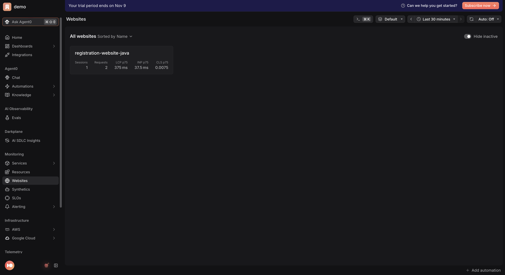
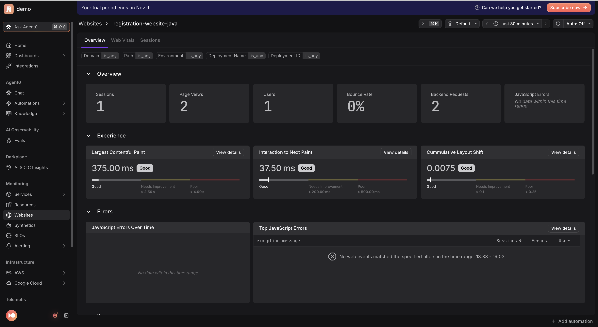
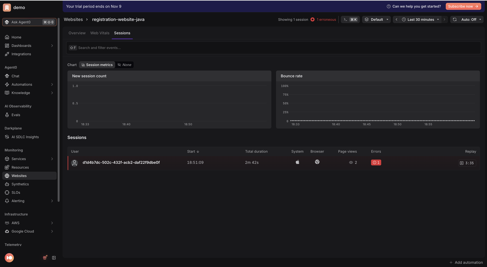
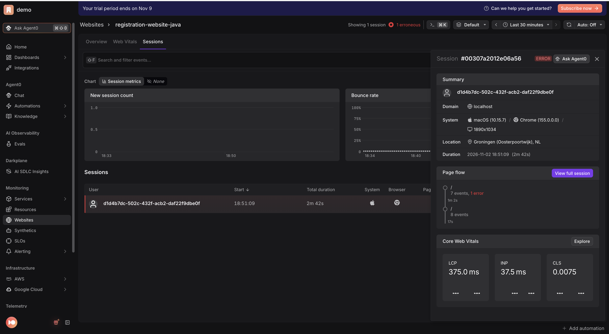
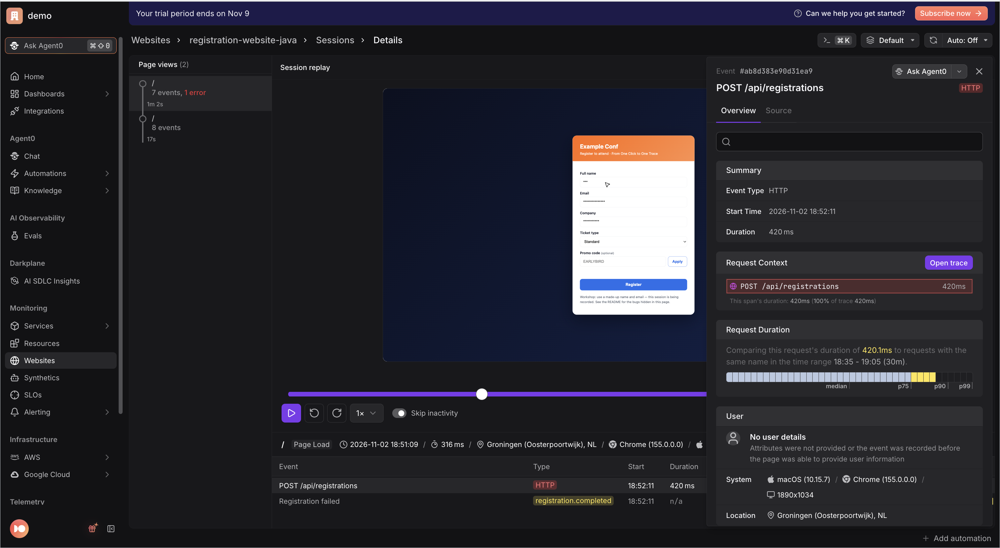
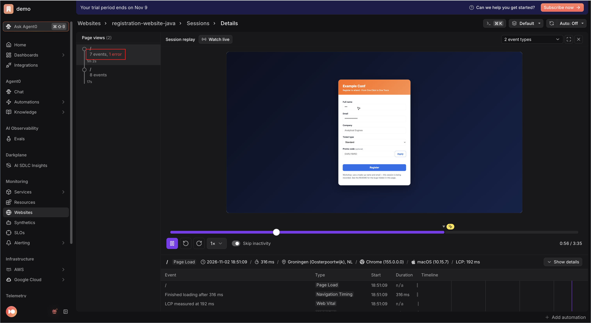

# From One Click to One Trace

Hands-on Session Replay workshop companion apps.

A small conference registration app, built twice over: two services with
OpenTelemetry traces, metrics and logs, and a registration page that runs the
[Dash0 Web SDK](https://github.com/dash0hq/dash0-sdk-web) with **session
replay** turned on. So besides what the services did, Dash0 also gets what
happened on the visitor's screen.

A trace answers "which span failed?". This workshop asks a question the
backend can't answer: **what did the person actually do?** The page hides four
bugs that live only in the browser. Three of them never reach a server, so no
backend trace, metric or log will ever show them. You find them by watching
the replay.

| App | Stack | Instrumentation |
|-----|-------|-----------------|
| [`apps/nodejs`](apps/nodejs) | Node.js + Express | `@opentelemetry/sdk-node` auto-instrumentation |
| [`apps/python`](apps/python) | Python + Flask | OpenTelemetry Python SDK (Flask + requests instrumentors) |
| [`apps/go`](apps/go) | Go + `net/http` | OpenTelemetry Go SDK + `otelhttp` |
| [`apps/java`](apps/java) | Java + Spring Boot | OpenTelemetry Java agent (`-javaagent`) |

Pick the stack you like. The browser side is the same for all four: every
frontend serves the same page from [`web/`](web/).

```
browser  (registration-website-<lang>)        Dash0 Web SDK + session replay
   │  click Register → fetch /api/registrations, with a traceparent header
   ▼
frontend (registration-web-<lang>)  ──HTTP──>  backend (registration-api-<lang>)
                                              validate → save → send email

browser, frontend and backend each send their own telemetry to Dash0.
One click = one trace across all three, and the replay links to it.
```

See [`apps/SPEC.md`](apps/SPEC.md) for the shared contract (ports, service
names, the browser contract, the deliberate bugs).

## 0. Get a Dash0 account

**"The Dash0 app"** is Dash0's web UI at **[app.dash0.com](https://app.dash0.com)**.
Sign up at **[dash0.com](https://www.dash0.com)**, which creates your
organization and logs you in. Everything in step 1 comes from inside the app.

**Cost:** Dash0 offers a **14-day free trial with no credit card required** and
full access to every feature, which is all you need for this workshop. Dash0
is otherwise a paid, usage-based product (there is no permanent free tier), so
the trial expires after 14 days. Check [dash0.com/pricing](https://www.dash0.com/pricing)
for current terms.

## 1. Get your Dash0 credentials (once)

You need **two** auth tokens this time: one for the services, and one for the
browser.

1. In the Dash0 app, click the name of your organization in the top left and
   then click **Settings**.

2. **Services token.** Go to **Settings → Auth Tokens** and create a token, or
   use the **Auto-generated auth token**. It looks like `auth_...`.
   <p></p>

3. **Browser token.** Create a second token in **Settings → Auth Tokens**, and
   give it permission to **ingest** data into your dataset and nothing else.
   This token ends up in the HTML of the page, so anyone who opens the page
   can read it. That is normal for browser telemetry, and it is why it must
   not be the token your services use.
   <p></p>

4. **Endpoint.** Go to **Settings → Endpoints → OTLP via HTTP** for your
   region-specific ingress URL (e.g. `https://ingress.eu-west-1.aws.dash0.com`).
   Use the **HTTP** endpoint, not gRPC: the services export with
   `OTEL_EXPORTER_OTLP_PROTOCOL=http/protobuf`, so a URL with a port must use
   `:4318`, never `:4317`. The browser sends to the same URL.
   <p></p>

5. Copy the template and fill it in:

   ```bash
   cp .env.example .env
   ```

   - `OTEL_EXPORTER_OTLP_ENDPOINT` → the endpoint from step 4.
   - `DASH0_AUTH_TOKEN` → the services token from step 2.
   - `DASH0_DATASET` → leave as `default` unless you use another dataset.
   - `DASH0_WEB_AUTH_TOKEN` → the browser token from step 3. If you leave it
     as `auth_REPLACE_ME`, the frontend falls back to `DASH0_AUTH_TOKEN` and
     prints a warning. That works on your own laptop; never do it on a public site.

All four apps read this same root `.env`.

## 2. Run an app

Open its folder's README and follow the steps:

- [Node.js](apps/nodejs/README.md)
- [Python](apps/python/README.md)
- [Go](apps/go/README.md)
- [Java](apps/java/README.md)

You start the backend, start the frontend, and open the frontend in a browser.
The page loads the SDK from `unpkg.com`, so your laptop needs internet access.
Use a **normal** browser window: some privacy extensions block telemetry
requests, and then no replay arrives.

**Check that it records.** Open the browser's developer tools, **Network** tab,
filter on `v1/`, and click around the form. Every few seconds you should see a
request to your Dash0 endpoint (`/v1/logs` carries the replay, `/v1/traces` the
requests). A `401` means the browser token is wrong.

**Use made-up data.** The session is recorded. Type `Ada Lovelace` and
`ada@example.com`, not your own name.

## 3. The exercises

Replays open in the **Websites** explorer. 

The **Sessions** list marks which sessions have a replay.

<p></p>

<p></p>

Opening one shows the replay above the session's event table. 

<p></p>

From any web event, **View full session** opens the replay at that moment. 

<p></p>

On an HTTP request, **View full trace** opens the backend trace it started.

<p></p>

A replay can take up to a minute to arrive after you stop clicking: the
recorder sends chunks every few seconds, and a session may still be "open".

### Exercise 1 — One click, one trace

1. Register once with made-up data and a normal email.
2. In Dash0, find your session. The quickest way: filter sessions by
   `user.id` = the **registration id** on your screen. The page calls
   `identify()` with that id after a successful registration. It deliberately
   does not use the email address.
3. Watch the replay. Notice that every field you typed into shows `****`:
   session replay masks all input values by default, in the browser, before
   anything is sent.
   <p></p>

4. Pause where you clicked **Register**. In the event table, open the HTTP
   request to `/api/registrations` and choose **View full trace**. You get
   one trace: the browser's request, `registration-web-<lang>`, then
   `registration-api-<lang>` with `validate-registration`, `save-registration`
   and `send-confirmation-email`.

That is the title of the workshop: from one click to one trace.

### Exercise 2 — A backend failure, seen from the screen

1. Register with an email containing `+fail`, e.g. `ada+fail@example.com`.
   The page turns red.
2. Find the session and watch the replay up to the red screen.
3. From the request in the event table, open the trace. The failing span is
   `send-confirmation-email`, with `error.type = invalid_recipient` (HTTP `422`).
4. Register a few more times with a normal email until one fails at random
   (about 15% do). That is `email_provider_unavailable` (HTTP `503`): the same
   red screen for the visitor, a very different problem for you.

You could find these from the backend alone. The replay adds the
part the trace can't: what the visitor saw, and what they did next.

### Exercise 3 — The bug the backend never saw

1. On a fresh form, type `earlybird` (lower case) into **Promo code**.
2. Click **Register**. Nothing happens. Click it again, three or four times in
   quick succession, the way an annoyed visitor would.
3. Look for this in your backend: there is no trace, no log and no metric.
   No request ever left the browser.
4. Now find the session. The replay timeline has an **error** marker and a
   **rage click** on `#submit`. The error says it could not read `discount`
   of `undefined`.
5. Watch the replay. You see the clicks. But what did the visitor type into
   the promo field? `****`.

You know *that* it broke and *where*. You can't see *why*, because the input
that triggers the bug is masked.

### Exercise 4 — Unmask what you need, and nothing else

The promo code is not personal data, so it is reasonable to record it.

1. Open [`web/index.html`](web/index.html) and uncomment the `maskInputFn`
   block under `EXERCISE 4`. It lets the `promoCode` field through and keeps
   masking every other input.
2. Reload the page (no restart needed: the frontends re-read `web/` on every
   request) and repeat exercise 3.
3. Watch the new replay. The promo field now shows `earlybird`, while name
   and email still show `****`.
4. Find the cause in [`web/registration.js`](web/registration.js): codes are
   looked up by exact match, and nothing handles an unknown code.

Discuss: masking is a decision you make per field, in the browser, at capture
time. Once a value has been sent, you can't take it back.

### Exercise 5 — The double submit

1. On a fresh form, **double-click Register**.
2. Look at the backend: two successful registrations. Nothing there looks
   wrong; every span is green.
3. Find the session. There are two HTTP requests, so two traces, a few
   milliseconds apart. In the replay, watch the registration id on screen
   change when the second response arrives.

The bug is that the button stays enabled and shows nothing while the request
is in flight. Each request is fine on its own. Only the session shows they
belong together.

### Exercise 6 — The button that does nothing

1. Register successfully, then click **Add to calendar** a few times.
2. Nothing happens. There is no error in the console, no failed request, no
   log line. By every signal except one, this page is healthy.
3. That one signal: a **rage click** on `#addToCalendar`. Find it in your
   session and watch the moment it happened.
4. Find the cause in `web/registration.js`.

Rage clicks are only detected while session replay is recording, so a rage
click always comes with the replay that shows it.

### Exercise 7 — Personal data in your replay

1. Open the replay from exercise 1 or 5 and watch the success screen.
2. "Thanks, Ada Lovelace! A confirmation is on its way to ada@example.com."
   The inputs were masked, but this is page **text**, and page text is not
   masked by default. The name and email are now stored in Dash0.
3. In `web/registration.js`, find the success paragraph (`renderSuccess`) and
   add `class="dash0-mask"` to it. Reload, register again, and check the new
   replay: that text is now asterisks.
4. If a part of a page should not be recorded at all, use `class="dash0-block"`
   instead: the replay shows an empty box of the same size.

## 4. Facilitator notes

**The deliberate bugs** (also in [`apps/SPEC.md`](apps/SPEC.md#deliberate-frontend-bugs)):

| Bug | Trigger | Backend sees | Dash0 shows for the browser | Exercise |
|-----|---------|--------------|-----------------------------|----------|
| Promo crash | promo code `earlybird`, then **Register** | nothing | JS error + rage click on `#submit` | 3, 4 |
| Double submit | double-click **Register** | two valid registrations | two requests, two traces, one session | 5 |
| Dead button | **Add to calendar** | nothing | only a rage click on `#addToCalendar` | 6 |
| Privacy leak | any success | — | name and email as plain text in the replay | 7 |
| Bad recipient | email with `+fail` | `422`, `invalid_recipient` | red screen; request links to the trace | 2 |
| Provider outage | ~15% at random | `503`, `email_provider_unavailable` | red screen; request links to the trace | 2 |

**What else the page sends.** Every outcome is also a custom web event,
`registration.completed`, with the same bounded attributes as the backend's
`registration.duration` metric (`…registration.ticket_type`, `outcome`,
`error.type`). The services also send traces, the metric and
correlated error logs.

**Sampling.** `web/index.html` records 100% of sessions, which is right for a
workshop and wrong for most production sites. `sessionRecording.samplingRate`
sets the share; recorded sessions are always a subset of the sessions the SDK
sends telemetry for.

<details>
<summary><strong>Solutions</strong></summary>

- **Promo crash:** normalise and check the code before using it:

  ```js
  var promo = PROMO_CODES[raw.trim().toUpperCase()];
  if (!promo) { promoStatus.textContent = "Unknown promo code"; return null; }
  ```

  and handle `null` in the submit handler instead of carrying on.
- **Double submit:** disable the button and show progress while the request
  is in flight; enable it again when the response arrives.
- **Dead button:** look up `addToCalendar`, the id the button actually has.
  Fixing it also makes the rage clicks stop, which is how you confirm the fix
  in Dash0.
- **Privacy leak:** `<p class="dash0-mask">Thanks, …</p>`.

</details>

---

> Workshop: **From One Click to One Trace: Hands-On Session Replay** — Dash0.
