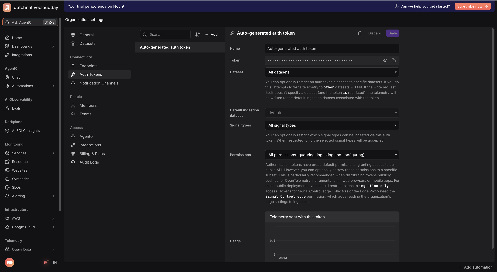
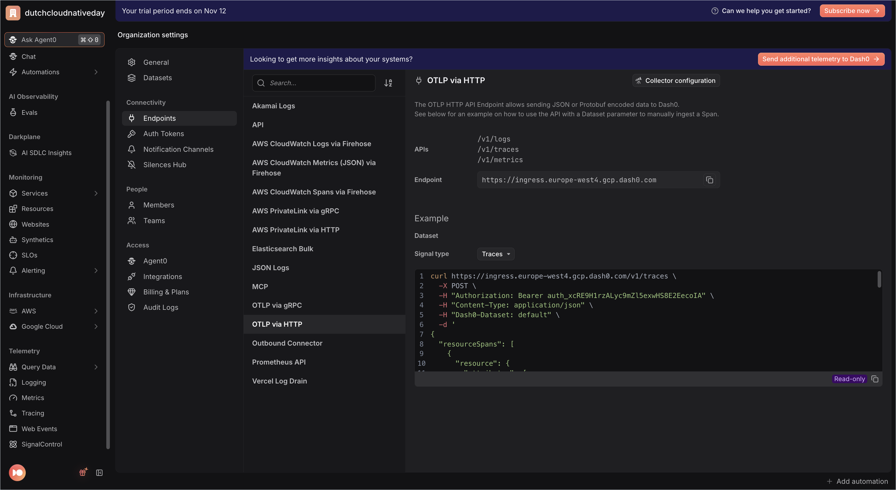

# Registration app — Go

> **Session Replay edition.** The frontend serves the shared registration page
> from the repo-root [`web/`](../../web/) folder. That page runs the Dash0 Web
> SDK with session replay as a third service, **`registration-website-go`**,
> and submits with `fetch` to `POST /api/registrations`, so one click is one
> trace: browser → `registration-web-go` → `registration-api-go`.
> This README gets the app running; the exercises are in the
> [root README](../../README.md#3-the-exercises).


Two services that together form **one end-to-end distributed trace** per
registration, exported to [Dash0](https://www.dash0.com) over OTLP/HTTP:

| Service  | Dir         | Port | `OTEL_SERVICE_NAME`    |
|----------|-------------|------|------------------------|
| Frontend | `frontend/` | 3200 | `registration-web-go`  |
| Backend  | `backend/`  | 3201 | `registration-api-go`  |

The browser posts the form to the **frontend**, which calls the **backend**
`POST /api/register` with the W3C `traceparent` header propagated, so a single
registration shows up as one trace spanning both services in Dash0.

OpenTelemetry is wired up **manually** (no Go runtime auto-instrumentation):
each service builds an OTLP/HTTP exporter in code and uses
`otelhttp` to instrument both its HTTP server and the frontend's outbound
HTTP client.

## 1. Prerequisites

- **Go 1.22** (`go version` → `go1.22.x`). Verified on darwin/arm64.
- A Dash0 account (free trial is fine).

## 2. Get your Dash0 credentials

Fill in the **repo-root** `.env` (not this folder). From the repo root:

```bash
cp .env.example .env
```

Then edit `.env`:

- **Auth token** — Dash0 app → **Settings → Auth Tokens** → create a token
  (`auth_...`), or use the **Auto-generated auth token**. Put it in
  `DASH0_AUTH_TOKEN`.
  <p></p>
- **OTLP endpoint** — Dash0 app → **Settings → Endpoints → OTLP via HTTP** shows
  your fully-resolved, region-specific ingress URL, e.g.
  `https://ingress.eu-west-1.aws.dash0.com`. Put it in
  `OTEL_EXPORTER_OTLP_ENDPOINT`. Use the **HTTP** endpoint (protocol is
  `http/protobuf`): if it carries a port it must be `:4318`, never `:4317`
  (gRPC → `HTTP 415`); no port is fine (defaults to 443).
  <p></p>
- `DASH0_DATASET` — leave as `default` unless you created another dataset.
- `OTEL_EXPORTER_OTLP_PROTOCOL` stays `http/protobuf`.

The auth headers (`Authorization: Bearer <token>` and `Dash0-Dataset`) are set
**in code** from `DASH0_AUTH_TOKEN` / `DASH0_DATASET` — you do not need to touch
`OTEL_EXPORTER_OTLP_HEADERS`.


**Browser token.** Also set `DASH0_WEB_AUTH_TOKEN` in the root `.env`: a
second, ingest-only token for the browser (see the
[root README, step 1](../../README.md#1-get-your-dash0-credentials-once)). The
frontend puts it in the page HTML; if it is unset, the frontend falls back to
`DASH0_AUTH_TOKEN` and prints a warning.

## 3. Install dependencies

Each service is its own Go module. From this folder:

```bash
(cd backend  && go mod tidy && go build ./...)
(cd frontend && go mod tidy && go build ./...)
```

## 4. Run it — backend first, then frontend (two terminals)

Each service has a `run.sh` that `cd`s to its own dir, sources the repo-root
`.env`, exports its `OTEL_SERVICE_NAME` / `PORT` (and `BACKEND_URL` for the
frontend), then launches with `go run .`.

Terminal 1 — backend (`registration-api-go`, port 3201):

```bash
./backend/run.sh
```

Terminal 2 — frontend (`registration-web-go`, port 3200):

```bash
./frontend/run.sh
```

Health checks: `curl localhost:3201/healthz` and `curl localhost:3200/healthz`
both return `ok`.

## 5. Open the page

Open **http://localhost:3200** in a normal browser window and register once
with made-up data (the session is recorded).

To check the browser is sending telemetry, open the developer tools,
**Network** tab, and filter on `v1/`: every few seconds you should see requests
to your Dash0 endpoint.

## 6. See it in Dash0

You now have three services in Dash0:

- **`registration-website-go`**: the browser. Sessions, page views, web
  vitals, errors, rage clicks and the session replay, in the **Websites**
  explorer.
- **`registration-web-go`**: the frontend (port 3200).
- **`registration-api-go`**: the backend (port 3201), with the child spans
  `validate-registration`, `save-registration` and `send-confirmation-email`,
  the `registration.duration` metric and correlated error logs.

Open your session, open the `/api/registrations` request from its event table
and choose **View full trace**: one trace from the browser through both
services.

Then work through the [exercises](../../README.md#3-the-exercises). The page's
code is in [`web/registration.js`](../../web/registration.js); every edit there
or in [`web/index.html`](../../web/index.html) shows up on the next reload,
without restarting the frontend.

## Notes

- If the Dash0 collector is unreachable the services still run — traces,
  metrics, and logs export is best-effort (batched / periodic) and export errors
  are logged, not fatal.
- **No PII in telemetry:** the full email address is never put on a span. Spans
  carry only `com.example.registration.email_domain` (the part after `@`), kept
  low-cardinality. The attendee email is shown in the web UI only.
- OTel module versions are pinned in each `go.mod` to a mutually compatible set
  (otel core `v1.30.0`, otelhttp contrib `v0.55.0`, logs/log-bridge `v0.x`
  matching). Run `go mod tidy` to resolve.
