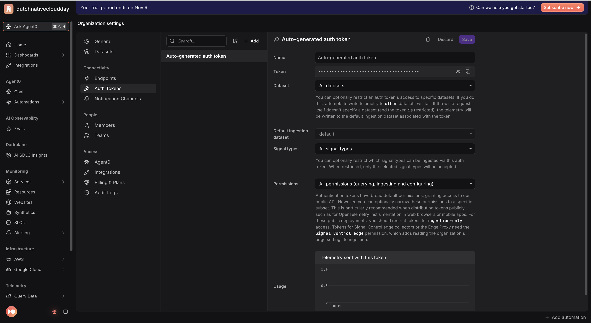
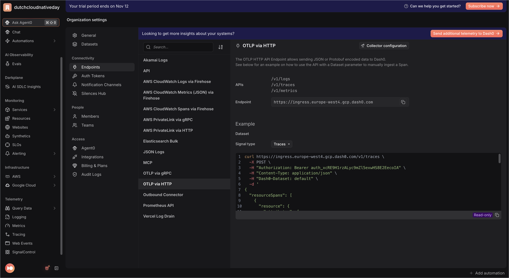

# Registration app — Java

> **Session Replay edition.** The frontend serves the shared registration page
> from the repo-root [`web/`](../../web/) folder. That page runs the Dash0 Web
> SDK with session replay as a third service, **`registration-website-java`**,
> and submits with `fetch` to `POST /api/registrations`, so one click is one
> trace: browser → `registration-web-java` → `registration-api-java`.
> This README gets the app running; the exercises are in the
> [root README](../../README.md#3-the-exercises).


Two Spring Boot services that together form **one end-to-end distributed trace**
in Dash0:

- **`registration-web-java`** (frontend, port **3300**) — serves the registration
  form and proxies submissions to the backend.
- **`registration-api-java`** (backend, port **3301**) — validates, "saves", and
  "emails" the registration, emitting three child spans.

Both services are instrumented by the **OpenTelemetry Java agent** (a
`-javaagent`, no OTel wiring in app code). The agent creates the server spans and
instruments the frontend's outbound HTTP client, so `traceparent` propagates
frontend → backend and the whole registration shows up as a single trace.

The backend additionally creates three **manual child spans** —
`validate-registration`, `save-registration`, `send-confirmation-email` — using
the OpenTelemetry API; the agent wires `GlobalOpenTelemetry` for these. It also
records a `registration.duration` histogram (via the agent's MeterProvider) and
logs failures through SLF4J, which the agent exports as OTLP log records
correlated to the trace.

Failures are classified with a bounded `error.type` and mapped to HTTP status:

| Condition | `error.type` | HTTP |
|-----------|--------------|------|
| empty/malformed name or email | `validation_error` | 400 |
| `ticketType` not in {standard, workshop, vip} | `unknown_ticket_type` | 400 |
| email contains `+fail` (bad recipient) | `invalid_recipient` | 422 |
| flaky provider (~15% random) | `email_provider_unavailable` | 503 |

The frontend mirrors the backend status (400/422/503) and uses 502 only when the
backend is unreachable.

---

## 1. Prerequisites

- **Java 21** (OpenJDK) — `java -version`
- **Maven 3.9** — `mvn -version`
- `curl` (to download the agent)

## 2. Get your Dash0 credentials

In the repo root, copy the example env file and fill it in:

```bash
cp .env.example .env      # run from the repository root
```

- **Auth token**: Dash0 app → **Settings → Auth Tokens** → create a token
  (`auth_...`), or use the **Auto-generated auth token** → put it in
  `DASH0_AUTH_TOKEN`.
  <p></p>
- **OTLP endpoint**: Dash0 app → **Settings → Endpoints → OTLP via HTTP** shows
  your fully-resolved, region-specific ingress URL
  (e.g. `https://ingress.eu-west-1.aws.dash0.com`) → put it in
  `OTEL_EXPORTER_OTLP_ENDPOINT`. Use the **HTTP** endpoint (protocol is
  `http/protobuf`): if it carries a port it must be `:4318`, never `:4317`
  (gRPC → `HTTP 415`); no port is fine (defaults to 443).
  <p></p>
- `OTEL_EXPORTER_OTLP_PROTOCOL` stays `http/protobuf`.
- `DASH0_DATASET` stays `default` (auto-created) unless you use another dataset.

The `run.sh` scripts source this root `.env` and build
`OTEL_EXPORTER_OTLP_HEADERS` (`Authorization=Bearer <token>,Dash0-Dataset=<dataset>`)
for the agent automatically.


**Browser token.** Also set `DASH0_WEB_AUTH_TOKEN` in the root `.env`: a
second, ingest-only token for the browser (see the
[root README, step 1](../../README.md#1-get-your-dash0-credentials-once)). The
frontend puts it in the page HTML; if it is unset, the frontend falls back to
`DASH0_AUTH_TOKEN` and prints a warning.

## 3. Download the OpenTelemetry Java agent

From this folder (`apps/java`):

```bash
./download-agent.sh
```

This fetches the latest `opentelemetry-javaagent.jar` into `apps/java/`. Both
`run.sh` scripts load it as `../opentelemetry-javaagent.jar`.

## 4. Build

Each project ships the **Maven wrapper** (`./mvnw`), so no system Maven is
required:

```bash
# from apps/java
( cd backend  && ./mvnw -q package -DskipTests )
( cd frontend && ./mvnw -q package -DskipTests )
```

(The `run.sh` scripts also build automatically with `./mvnw` if the jar is
missing.)

## 5. Run — backend first, then frontend (two terminals)

**Terminal 1 — backend:**

```bash
cd apps/java/backend
./run.sh      # OTEL_SERVICE_NAME=registration-api-java, listens on :3301
```

**Terminal 2 — frontend:**

```bash
cd apps/java/frontend
./run.sh      # OTEL_SERVICE_NAME=registration-web-java, listens on :3300
```

Each `run.sh` sources the root `.env`, exports its `OTEL_SERVICE_NAME` / `PORT`
(the frontend also sets `BACKEND_URL`, default `http://localhost:3301`), then
launches the jar with the javaagent.

Health checks:

```bash
curl localhost:3301/healthz    # backend  -> ok
curl localhost:3300/healthz    # frontend -> ok
```

## 6. Open the page

Open **http://localhost:3300** in a normal browser window and register once
with made-up data (the session is recorded).

To check the browser is sending telemetry, open the developer tools,
**Network** tab, and filter on `v1/`: every few seconds you should see requests
to your Dash0 endpoint.

## 7. See it in Dash0

You now have three services in Dash0:

- **`registration-website-java`**: the browser. Sessions, page views, web
  vitals, errors, rage clicks and the session replay, in the **Websites**
  explorer.
- **`registration-web-java`**: the frontend (port 3300).
- **`registration-api-java`**: the backend (port 3301), with the child spans
  `validate-registration`, `save-registration` and `send-confirmation-email`,
  the `registration.duration` metric and correlated error logs.

Open your session, open the `/api/registrations` request from its event table
and choose **Open trace**: one trace from the browser through both
services.

Then work through the [exercises](../../README.md#3-the-exercises). The page's
code is in [`web/registration.js`](../../web/registration.js); every edit there
or in [`web/index.html`](../../web/index.html) shows up on the next reload,
without restarting the frontend.

## Notes

- Dependencies are intentionally minimal: `spring-boot-starter-web` for both,
  plus `opentelemetry-api` on the backend (only to create the three manual
  spans and the `registration.duration` histogram). All exporting — traces,
  metrics, and logs — comes from the javaagent; no OTel SDK wiring in app code.
- Failure logs use SLF4J/Logback (bundled with `spring-boot-starter-web`); the
  agent's log appender exports them over OTLP automatically.
- The Maven wrapper (`.mvn/wrapper/`, `mvnw`, `mvnw.cmd`) is committed so the app
  builds without a system Maven.
- Ports are fixed by the workshop so all languages can run at once:
  frontend **3300**, backend **3301**.
