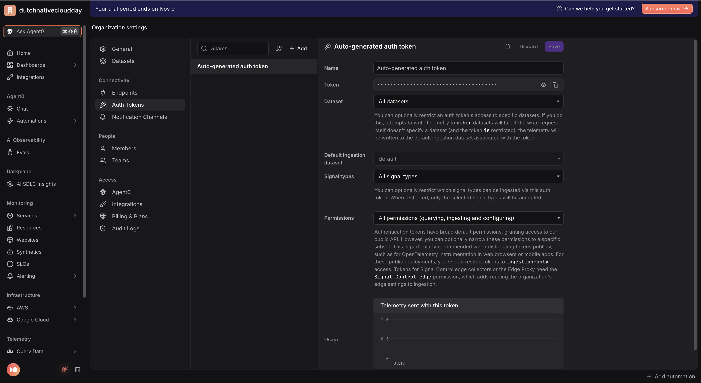
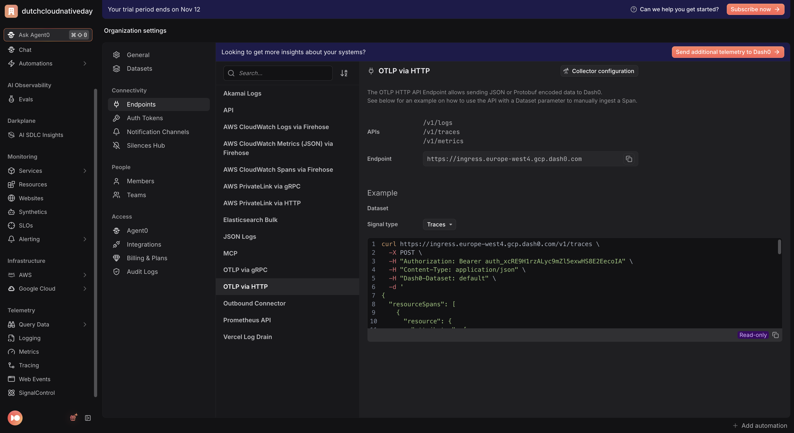

# Registration app — Node.js

> **Session Replay edition.** The frontend serves the shared registration page
> from the repo-root [`web/`](../../web/) folder. That page runs the Dash0 Web
> SDK with session replay as a third service, **`registration-website-node`**,
> and submits with `fetch` to `POST /api/registrations`, so one click is one
> trace: browser → `registration-web-node` → `registration-api-node`.
> This README gets the app running; the exercises are in the
> [root README](../../README.md#3-the-exercises).


The Node.js implementation of the Example Conf registration app:
two services (a web **frontend** and an API **backend**) wired with
OpenTelemetry so a single registration shows up in Dash0 as **one end-to-end
distributed trace spanning both services**.

| Service  | Role                         | Port | `OTEL_SERVICE_NAME`     |
|----------|------------------------------|------|-------------------------|
| browser  | The page: Web SDK + session replay | — | `registration-website-node` |
| frontend | Serves the page, calls the API | 3000 | `registration-web-node` |
| backend  | Validates, saves, emails     | 3001 | `registration-api-node` |

See [`../SPEC.md`](../SPEC.md) for the shared contract all languages implement.

## 1. Prerequisites

- **Node.js 20** and **npm 10** (verified with Node v20.20, npm 10.8). Node 20
  ships a global `fetch` (undici), which the frontend uses to call the backend.
- A Dash0 account (free trial is fine).

## 2. Get your Dash0 credentials

1. **Auth token:** Dash0 app → **Settings → Auth Tokens** → create a token
   (starts with `auth_...`), or use the **Auto-generated auth token**.
   <p></p>
2. **OTLP endpoint:** Dash0 app → **Settings → Endpoints → OTLP via HTTP** shows
   your fully-resolved, region-specific ingress URL, e.g.
   `https://ingress.eu-west-1.aws.dash0.com`. Use the **HTTP** endpoint (protocol
   is `http/protobuf`): if it carries a port it must be `:4318`, never `:4317`
   (gRPC → `HTTP 415`); no port is fine (defaults to 443).
   <p></p>

Fill these into the **root** `.env` (shared by every app in this repo):

```bash
cd ../..                 # repo root
cp .env.example .env      # if you haven't already
# then edit .env:
#   OTEL_EXPORTER_OTLP_ENDPOINT=https://ingress.<region>.aws.dash0.com
#   OTEL_EXPORTER_OTLP_PROTOCOL=http/protobuf
#   DASH0_AUTH_TOKEN=auth_...
#   DASH0_DATASET=default
#   DASH0_WEB_AUTH_TOKEN=auth_...   # browser token, ingest-only
```

**How the root `.env` is used:** each service's `run.sh` `cd`s into its own
directory, `source`s the repo-root `.env` (so the shared OTLP settings and your
Dash0 token/dataset are in the environment), then exports its own
`OTEL_SERVICE_NAME` / `PORT` (and `BACKEND_URL` for the frontend) before
launching. The OTLP **auth headers** (`Authorization: Bearer <token>` and
`Dash0-Dataset: <dataset>`) are built **in code** in `tracing.js` from
`DASH0_AUTH_TOKEN` / `DASH0_DATASET` — this is more robust than sourcing
`OTEL_EXPORTER_OTLP_HEADERS` through the shell.


**Browser token.** Also set `DASH0_WEB_AUTH_TOKEN` in the root `.env`: a
second, ingest-only token for the browser (see the
[root README, step 1](../../README.md#1-get-your-dash0-credentials-once)). The
frontend puts it in the page HTML; if it is unset, the frontend falls back to
`DASH0_AUTH_TOKEN` and prints a warning.

## 3. Install dependencies

```bash
cd backend && npm install && cd ..
cd frontend && npm install && cd ..
```

## 4. Run it — backend first, then frontend (two terminals)

Each service is launched with `node -r ./tracing.js server.js` so that
OpenTelemetry's auto-instrumentations patch `express`, `http`, and
`undici`/`fetch` **before** the app loads. The `run.sh` scripts do this for you.

**Terminal 1 — backend:**

```bash
cd backend
./run.sh          # OTEL_SERVICE_NAME=registration-api-node, PORT=3001
```

**Terminal 2 — frontend:**

```bash
cd frontend
./run.sh          # OTEL_SERVICE_NAME=registration-web-node, PORT=3000, BACKEND_URL=http://localhost:3001, WEB_DIR=<repo>/web
```

(If you prefer npm: `npm start` runs the same command, but then you must export
`OTEL_SERVICE_NAME`/`PORT`/`BACKEND_URL` and source `.env` yourself — `run.sh`
is the copy-pasteable path.)

## 5. Open the page

Open **http://localhost:3000** in a normal browser window and register once
with made-up data (the session is recorded).

To check the browser is sending telemetry, open the developer tools,
**Network** tab, and filter on `v1/`: every few seconds you should see requests
to your Dash0 endpoint.

## 6. See it in Dash0

You now have three services in Dash0:

- **`registration-website-node`**: the browser. Sessions, page views, web
  vitals, errors, rage clicks and the session replay, in the **Websites**
  explorer.
- **`registration-web-node`**: the frontend (port 3000).
- **`registration-api-node`**: the backend (port 3001), with the child spans
  `validate-registration`, `save-registration` and `send-confirmation-email`,
  the `registration.duration` metric and correlated error logs.

Open your session, open the `/api/registrations` request from its event table
and choose **View full trace**: one trace from the browser through both
services.

Then work through the [exercises](../../README.md#3-the-exercises). The page's
code is in [`web/registration.js`](../../web/registration.js); every edit there
or in [`web/index.html`](../../web/index.html) shows up on the next reload,
without restarting the frontend.

## Project layout

```
apps/nodejs/
├── backend/
│   ├── tracing.js      # OTel bootstrap: NodeSDK + OTLP/proto trace, metric & log exporters + auto-instrumentations
│   ├── server.js       # Express API: POST /api/register (error model + registration.duration metric + error logs), GET /healthz
│   ├── package.json
│   └── run.sh
├── frontend/
│   ├── tracing.js      # same OTel bootstrap
│   ├── server.js       # Express web: GET / and /static/registration.js (from ../../../web), POST /api/registrations (JSON, for the page), POST /register (no-JS fallback), GET /healthz
│   ├── package.json
│   └── run.sh
└── README.md
```
