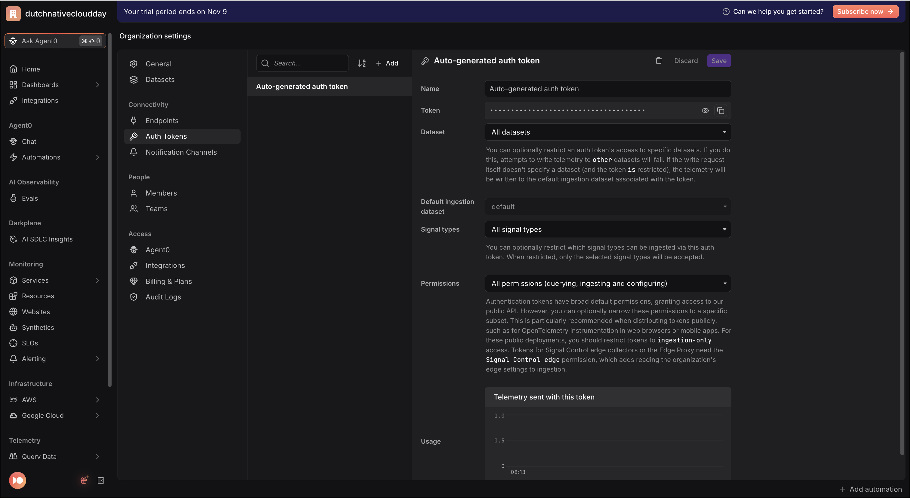
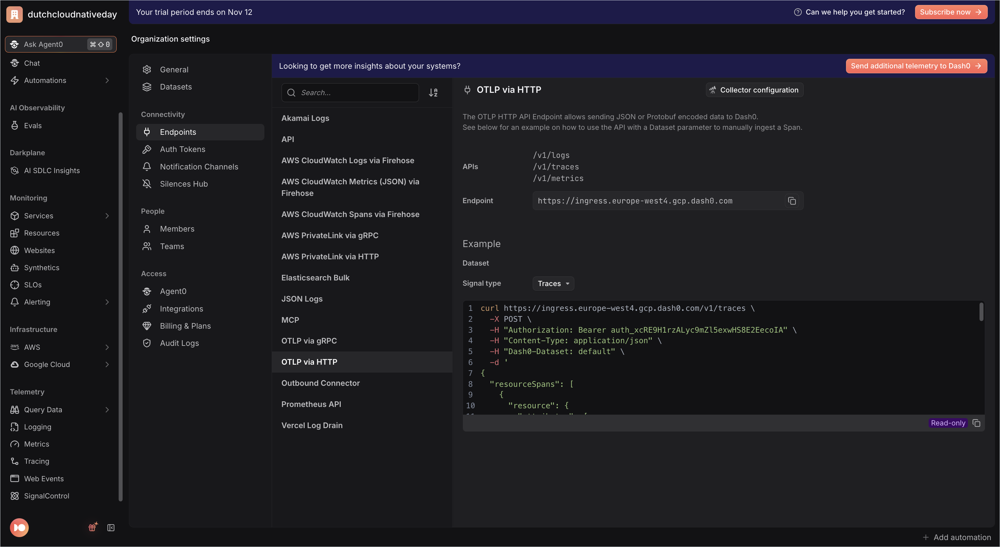

# Registration app — Python (Flask + OpenTelemetry)

> **Session Replay edition.** The frontend serves the shared registration page
> from the repo-root [`web/`](../../web/) folder. That page runs the Dash0 Web
> SDK with session replay as a third service, **`registration-website-python`**,
> and submits with `fetch` to `POST /api/registrations`, so one click is one
> trace: browser → `registration-web-python` → `registration-api-python`.
> This README gets the app running; the exercises are in the
> [root README](../../README.md#3-the-exercises).


The Python implementation of the workshop app. Two Flask services export OTLP/HTTP traces
to Dash0, and trace context propagates frontend → backend so a single
registration shows up as **one end-to-end distributed trace across two
services**.

| Service    | Dir         | `OTEL_SERVICE_NAME`        | Port |
|------------|-------------|----------------------------|------|
| Frontend   | `frontend/` | `registration-web-python`  | 3100 |
| Backend    | `backend/`  | `registration-api-python`  | 3101 |

The frontend serves the shared registration page (`web/`) and forwards each
registration to the backend
`POST /api/register`, which runs three child spans — `validate-registration`,
`save-registration`, `send-confirmation-email` — under the auto-created server
span. OpenTelemetry is configured **programmatically** in `otel_setup.py` (no
`opentelemetry-instrument` agent), so the Dash0 auth headers are set in code and
survive shell quirks. All three signals go to Dash0 over OTLP/HTTP:

- **Traces** — the distributed trace across both services.
- **Metrics** — the backend records one `registration.duration` histogram
  (unit `s`) per request, with bounded attributes `com.example.registration.ticket_type`,
  `outcome` (`confirmed`/`failed`) and, on failure, `error.type`.
- **Logs** — on a failure the backend emits one correlated OTel log record at
  severity `ERROR` (bridged from the stdlib logger); successes do not log.

### Error model

Each failure is classified with a bounded `error.type` and mapped to a status:

| Condition | `error.type` | HTTP |
|-----------|--------------|------|
| name/email empty or malformed | `validation_error` | 400 |
| `ticketType` not `standard`/`workshop`/`vip` | `unknown_ticket_type` | 400 |
| email contains `+fail` (bad recipient) | `invalid_recipient` | 422 |
| flaky provider (~15% random) | `email_provider_unavailable` | 503 |

Failure body: `{"status":"error","errorType":"...","message":"..."}`. The error
is recorded exactly once, on the single child span where it occurs. The full
email address is never put on telemetry — only `com.example.registration.email_domain`.

## 1. Prerequisites

- **Python 3.9+** (verified on Python 3.9.6 / pip 21).
- A Dash0 account.

## 2. Get your Dash0 credentials

Fill in the repo-root `.env` (one file shared by every language). From the repo
root:

```bash
cp .env.example .env
```

Then edit `.env`:

- **`DASH0_AUTH_TOKEN`** — Dash0 app → **Settings → Auth Tokens** → create a
  token (starts with `auth_`), or use the **Auto-generated auth token**.
  <p></p>
- **`OTEL_EXPORTER_OTLP_ENDPOINT`** — Dash0 app → **Settings → Endpoints → OTLP
  via HTTP** shows your fully-resolved, region-specific ingress URL, e.g.
  `https://ingress.eu-west-1.aws.dash0.com`. Use the **HTTP** endpoint (protocol
  is `http/protobuf`): if it carries a port it must be `:4318`, never `:4317`
  (gRPC → `HTTP 415`); no port is fine (defaults to 443).
  <p></p>
- **`DASH0_DATASET`** — target dataset (`default` is auto-created).
- `OTEL_EXPORTER_OTLP_PROTOCOL` stays `http/protobuf`.

Each service's `run.sh` sources this root `.env`, and `otel_setup.py` builds the
exporter headers (`Authorization: Bearer <token>`, `Dash0-Dataset: <dataset>`)
from it in code.


**Browser token.** Also set `DASH0_WEB_AUTH_TOKEN` in the root `.env`: a
second, ingest-only token for the browser (see the
[root README, step 1](../../README.md#1-get-your-dash0-credentials-once)). The
frontend puts it in the page HTML; if it is unset, the frontend falls back to
`DASH0_AUTH_TOKEN` and prints a warning.

## 3. Install dependencies

Each service uses its own isolated virtualenv. Run once per service:

```bash
# Backend
cd apps/python/backend
python3 -m venv venv
./venv/bin/pip install -r requirements.txt

# Frontend
cd ../frontend
python3 -m venv venv
./venv/bin/pip install -r requirements.txt
```

## 4. Run the services

Open **two terminals** from the repo root. `run.sh` activates the venv, sources
the root `.env`, exports the per-service `OTEL_SERVICE_NAME` / `PORT`
(/ `BACKEND_URL`), and runs `python app.py`.

Terminal 1 — backend first:

```bash
cd apps/python/backend
./run.sh
# → registration-api-python on http://localhost:3101
```

Terminal 2 — frontend:

```bash
cd apps/python/frontend
./run.sh
# → registration-web-python on http://localhost:3100
```

Health checks: `curl http://localhost:3101/healthz` and
`curl http://localhost:3100/healthz` both return `ok`.

## 5. Open the page

Open **http://localhost:3100** in a normal browser window and register once
with made-up data (the session is recorded).

To check the browser is sending telemetry, open the developer tools,
**Network** tab, and filter on `v1/`: every few seconds you should see requests
to your Dash0 endpoint.

## 6. See it in Dash0

You now have three services in Dash0:

- **`registration-website-python`**: the browser. Sessions, page views, web
  vitals, errors, rage clicks and the session replay, in the **Websites**
  explorer.
- **`registration-web-python`**: the frontend (port 3100).
- **`registration-api-python`**: the backend (port 3101), with the child spans
  `validate-registration`, `save-registration` and `send-confirmation-email`,
  the `registration.duration` metric and correlated error logs.

Open your session, open the `/api/registrations` request from its event table
and choose **Open trace**: one trace from the browser through both
services.

Then work through the [exercises](../../README.md#3-the-exercises). The page's
code is in [`web/registration.js`](../../web/registration.js); every edit there
or in [`web/index.html`](../../web/index.html) shows up on the next reload,
without restarting the frontend.

## Notes

- Run with plain `python app.py` (`run.sh` does this). The reloader is disabled
  (`use_reloader=False`) so the tracer provider is not initialised twice.
- If the OTLP collector/Dash0 is unreachable, the app keeps serving requests;
  the span/log batch processors and the periodic metric reader just fail the
  export in the background without affecting the request.
- On macOS system Python you may see a harmless `NotOpenSSLWarning` from urllib3
  (LibreSSL). It does not affect the app.
